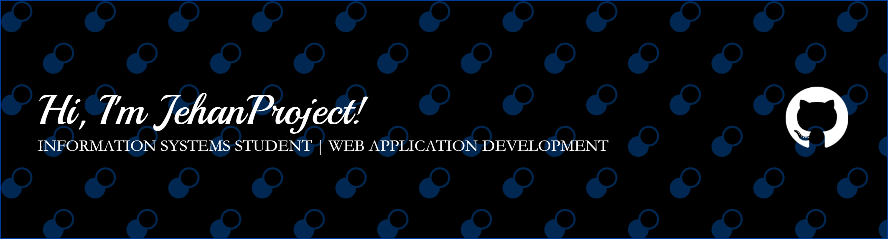

### Hey, nice to see you! 👋

I'm **JehanProject**, an Information Systems student learning and building web applications. I use this profile to share my projects and technical learning.

#### 🧰 Technologies across my projects

  
  
  
  
  
  
  
  
  
  
  
  
  
  

#### Other dependencies in project manifests

  
  
  
  
  
  
  
  

#### 📊 GitHub Stats

  
  

#### 🎧 Spotify

#### 📈 Contribution Activity

#### 🚀 Projects

| Project | Description | Technologies |
| --- | --- | --- |
| [Integrated Operational Management System for Mira Plastik Store](https://github.com/JehanProject/Sistem-Manajemen-Operasional-Terintegrasi-Toko-Mira-Plastik) | Internal application for inventory, sales, receivables, and operational reporting. | PHP, CodeIgniter 4, MySQL/MariaDB, Bootstrap |

#### 📫 Contact

- **Location:** Padang, West Sumatra, Indonesia
- **Instagram:** [@je_hann022](https://www.instagram.com/je_hann022/)
- **GitHub:** [JehanProject](https://github.com/JehanProject)
